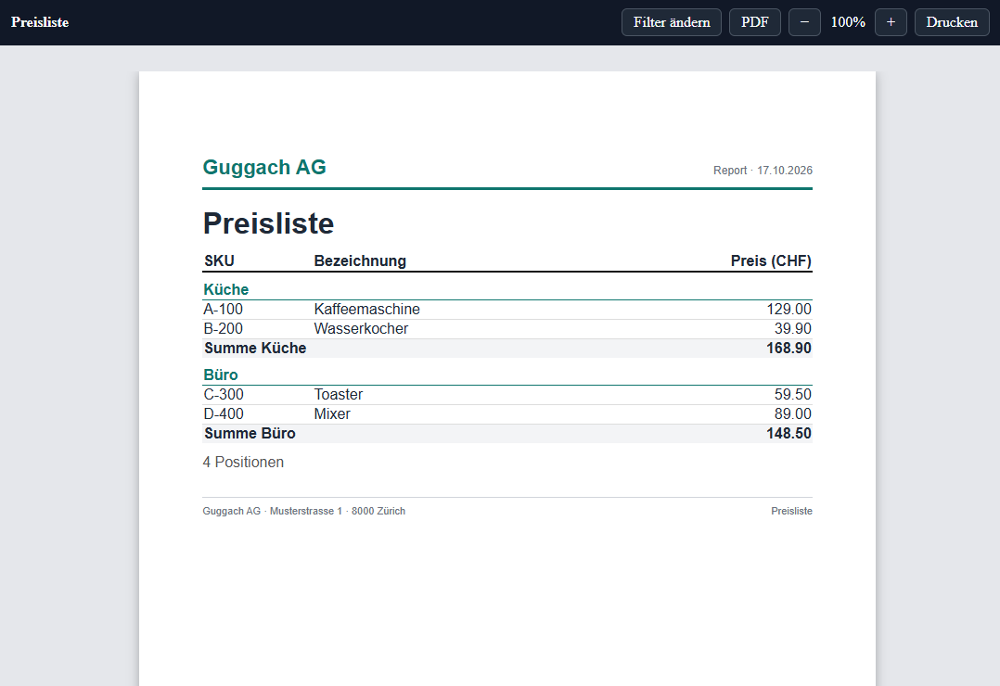

# Laravel Reports — Documentation & Demo

A Laravel application that documents and demonstrates
[`guggach/laravel-reports`](https://github.com/guggach/laravel-reports):
print-ready reports built with PHP and Blade, with band control, strict
pagination, free-form invoices, database sources, filters, aggregates and
locale-aware formatting.



> The package is under active development. The demo tracks the current
> `main` branch of the package and is not a stable release.

## What is inside

- A localized documentation site (English by default, German under `/de`)
- 8 runnable example reports, each with source code and a live preview
- A live filter form, HTML preview frame, and PDF output
- Examples for Flow, Strict, N-up, free-form, database sources, and i18n
- A group-enrichment example using an Eloquent model with translated data

## Requirements

- PHP 8.3 or newer
- Composer 2
- Node.js 20 or newer and npm
- SQLite (the demo uses a local SQLite database)
- Chromium for PDF generation (Playwright-managed, or set
  `LARAVEL_PDF_CHROME_BINARY`)

## Getting started

The demo consumes the package through a Composer **path repository**. Clone
both repositories next to each other:

```bash
mkdir laravel-reports-demo
cd laravel-reports-demo

git clone https://github.com/guggach/laravel-reports.git
git clone https://github.com/guggach/laravel-reports-doc-demo.git

cd laravel-reports-doc-demo
```

Install the PHP dependencies:

```bash
composer install
```

If the package is not at `../laravel-reports`, adjust the `repositories` entry
in `composer.json`:

```json
"repositories": [{
    "type": "path",
    "url": "../laravel-reports"
}]
```

Create the environment and database:

```bash
cp .env.example .env
php artisan key:generate
touch database/database.sqlite
php artisan migrate
```

Install the frontend assets and the Chromium binary used for PDF output:

```bash
npm install
npx playwright install chromium
npm run build
```

Start the application:

```bash
php artisan serve
```

Open <http://localhost:8000>.

For frontend development, use `npm run dev` instead of `npm run build`.

## URLs

| URL | What it shows |
|---|---|
| `/` | Landing page |
| `/docs` | Documentation index |
| `/docs/{page}` | A documentation chapter, e.g. `/docs/groups`, `/docs/multilanguage` |
| `/examples` | All example reports |
| `/examples/{key}` | Source code and live links for one example |
| `/reports/{key}` | Filter form, or a redirect to the preview when the report has no filters |
| `/reports/{key}/run` | Preview frame with HTML document and PDF button |
| `/reports/{key}/pdf` | Streamed PDF |
| `/de/...` | German version of the documentation and examples |

The report routes are intentionally not localized: `/reports/...` is shared by
both languages and follows the language selected in the preview frame.

## Example reports

| Key | Demonstrates |
|---|---|
| `price_list` | Flow report with groups, subtotals, filters and typed filter controls |
| `packing_list` | Strict pagination with fixed band heights, repeated grid header and page numbers |
| `label_sheet` | N-up detail bands: four labels per row, with the row as pagination unit |
| `invoice_example` | Strict free-form invoice with page blocks and a Swiss QR payment slip |
| `contract_example` | Flow free-form contract with general terms starting on page 2 |
| `database_sources` | The same report through Query, Eloquent, Raw SQL, Collection and Array sources |
| `multilanguage` | Module translations, locale-aware dates/numbers and a frame language selector |
| `group_enrichment` | Group data loaded once per group from an Eloquent model with translated attributes |

Every example page at `/examples/{key}` shows the module structure and the
actual source files, highlighted from disk.

## Documentation chapters

- Getting started
- Routing & invocation
- Report types
- Bands explained
- Report definition
- Data sources
- Groups & aggregates — including aggregate scope and group enrichment
- Filter form
- Multilingual reports

The documentation is rendered from Blade views under `resources/views/docs`
and registered in `config/docs.php`.

## Report module structure

Each report is self-contained under `app/Reports/<Name>/`:

```
app/Reports/PriceList/
├── Report.php
├── Source.php
├── lang/
│   ├── de/report.php
│   └── en/report.php
└── views/
    ├── report-start.blade.php
    ├── grid-head.blade.php
    ├── row.blade.php
    ├── category-head.blade.php
    ├── category-foot.blade.php
    └── report-end.blade.php
```

The package discovers reports under `app/Reports`, resolves their views and
language files automatically, and exposes them through `/reports/{key}`.

## PDF generation

PDFs are produced by `spatie/laravel-pdf` with its Chrome driver. The demo
auto-detects Playwright's Chromium installation:

```text
~/.cache/ms-playwright/chromium-*/chrome-linux64/chrome
```

If Chromium lives elsewhere, set the binary explicitly:

```bash
LARAVEL_PDF_CHROME_BINARY=/usr/bin/chromium php artisan serve
```

Without a Chromium binary the HTML preview still works; the PDF route will
report a converter error.

## Tests

Fast application tests:

```bash
php artisan test tests/Feature
```

Browser tests (requires the Playwright Chromium installation above):

```bash
php artisan test tests/Browser
```

The package itself has its own test suite:

```bash
cd ../laravel-reports
composer test
```

## Project structure

```
app/
├── Http/Controllers/DocsController.php
├── Models/
└── Reports/                 # self-contained report modules
config/
├── docs.php                 # documentation pages + example registry
└── reports.php              # package config
database/migrations/         # demo data, including report examples
resources/views/
├── docs/                    # documentation chapters
├── examples/                # example index and source viewer
└── layouts/                 # documentation layout
routes/web.php               # localized docs + report routes
```

## Related repositories

- Package: <https://github.com/guggach/laravel-reports>
- Demo: <https://github.com/guggach/laravel-reports-doc-demo>

## License

MIT. See [LICENSE](LICENSE).
